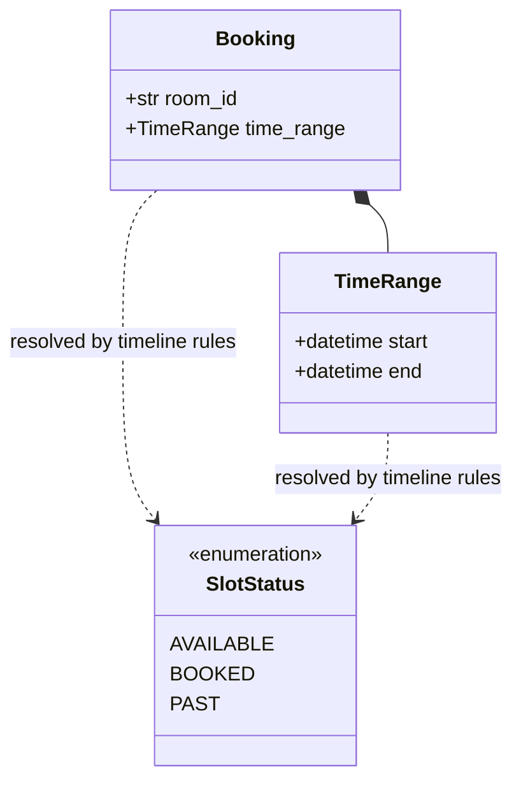
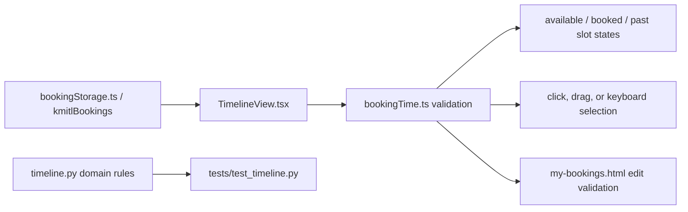
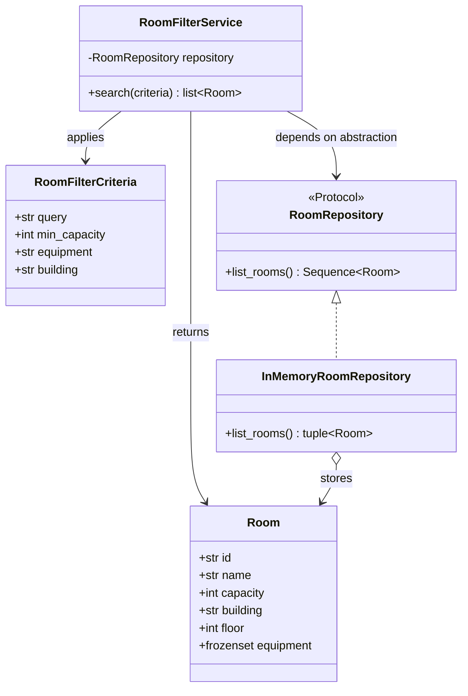

# Booking timeline and room filtering architecture

## Booking timeline

The booking homepage is built with Vite, React, and TypeScript. `src/main.tsx`
mounts `BookingApp`, which renders the interactive `TimelineView.tsx` with
30-minute slots from 07:00 to 17:00. Slots can be selected by click, pointer
drag, or keyboard; available, booked, and past states are derived from the
selected date and current booking data.

`src/utils/bookingTime.ts` is the shared source for date/time validation,
half-open overlap checks (`[start, end)`), cancelled-booking handling, and slot
status. Both the timeline and booking edit form use these rules.
`src/utils/bookingStorage.ts` normalizes supported legacy booking shapes and
uses the `kmitlBookings` storage key shared with the existing browser scripts.

Install and run the browser app from this directory:

```sh
npm install
npm run dev
npm test
```

`npm run build` type-checks the TypeScript sources and creates the production
build in `dist/`. Python domain tests run with
`python -m unittest discover -s tests`.

The Python `timeline.py` module contains matching, independently testable
domain rules. `TimeRange` and `Booking` are immutable values;
`find_conflicts`, `get_room_status`, and `select_room_slot` keep overlap,
room-specific status, and selection validation separate from the UI.





The Python rules are not called directly by the browser; they provide a tested
domain implementation for Python workflows and future API integration. The
browser applies the same half-open overlap rule locally.

## Room filtering

Room filtering is implemented as a Python application service, separate from
the browser UI. This keeps its domain rules independently testable and avoids
coupling the service to HTML, JavaScript, or a particular persistence provider.



`Room` and `RoomFilterCriteria` are immutable domain values. The repository
protocol isolates data access, and `RoomFilterService` applies all supplied
criteria conjunctively. `MOCK_ROOMS` provides sample data through
`mock_data.py`; production storage can be added behind `RoomRepository` without
changing the filtering service.

The current browser pages continue to use their existing JavaScript behavior.
The Python service is not connected to the browser or exposed over HTTP; an API
adapter can be added separately if server-side integration is needed.
