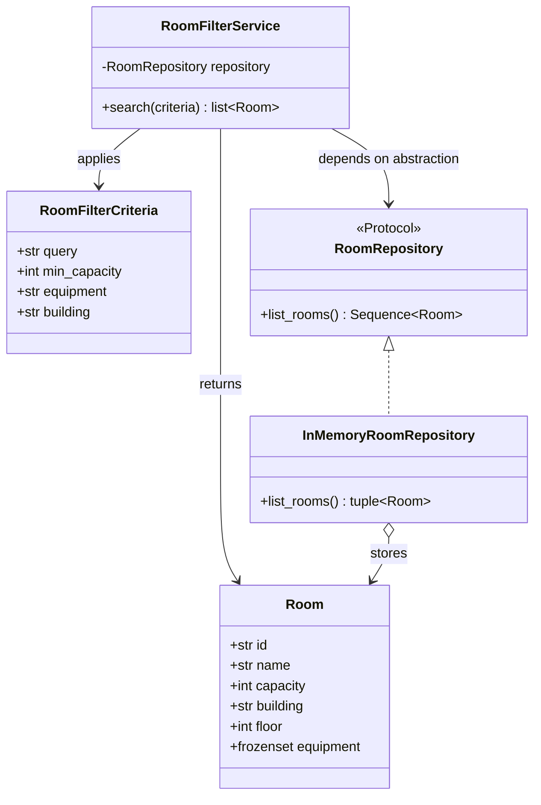

# Booking application architecture

## Browser application

The static HTML pages share their browser-side helpers from `js/common.js`.
`js/booking.js` initializes the booking controller on `index.html` and exposes
the shared local-storage booking adapter; `js/statistics.js` powers the
statistics page. The old, unused script copies under `dashboard/` have been
removed so there is one canonical browser JavaScript directory.

The `my-bookings.html` page mounts the React application from `src/main.tsx`.
Its `AuthContext` reads the same `kmitlCurrentUser` value as the existing
login/register pages, and its booking component reads and updates the existing
`my_bookings_preview_data` and `bookings` storage keys. The ICS generator is
imported directly by the React component.

Install dependencies with `npm install`, run the local app with `npm run dev`,
and create a production build of all HTML pages with `npm run build`. The
generated static site is written to `dist/`.

## Room filtering

Room filtering is implemented as a Python application service, separate from
the browser UI. This keeps its domain rules independently testable and avoids
coupling the service to HTML, JavaScript, or a particular persistence provider.

`Room` and `RoomFilterCriteria` are immutable domain values. The repository
protocol isolates data access, and `RoomFilterService` applies all supplied
criteria conjunctively. `MOCK_ROOMS` provides sample data through
`mock_data.py`; production storage can be added behind `RoomRepository` without
changing the filtering service.

The current browser pages continue to use their existing JavaScript behavior.
The Python service is not connected to the browser or exposed over HTTP; an API
adapter can be added separately if server-side integration is needed.
