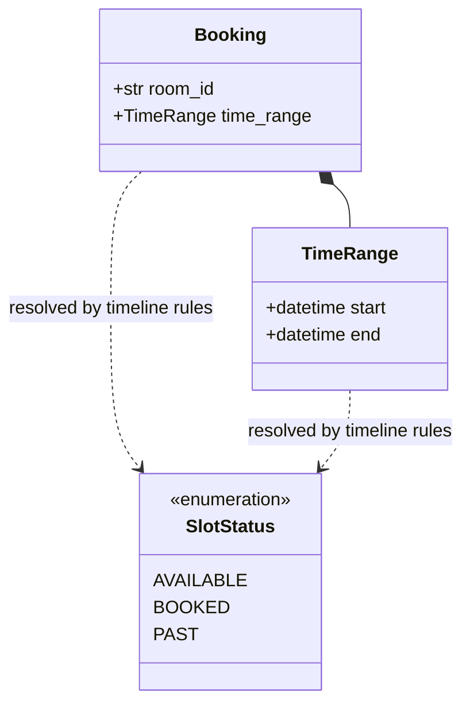
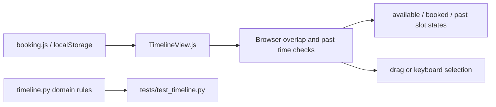
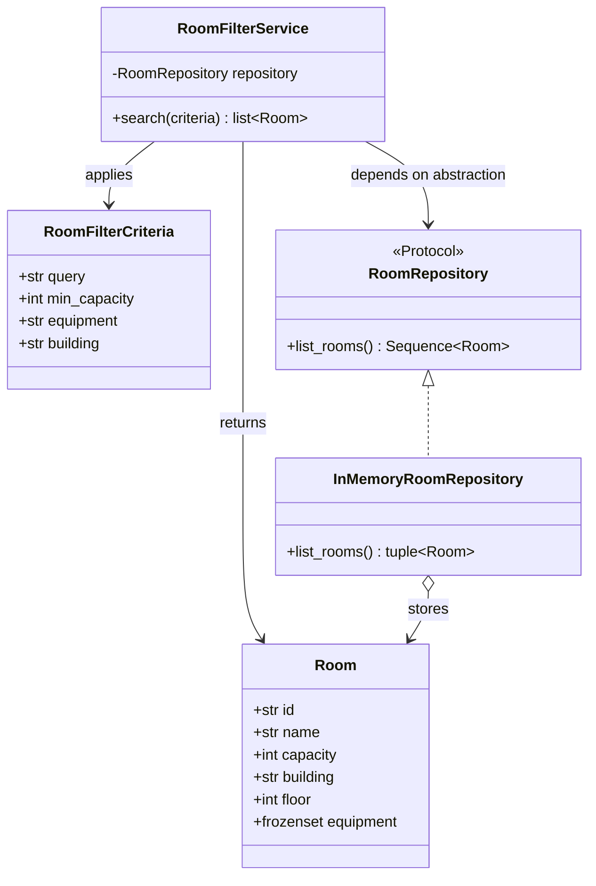

# Booking timeline and room filtering architecture

## Booking timeline

The browser timeline stays in the project's existing HTML and JavaScript stack;
there is no React or TypeScript build configuration, so the interactive
`TimelineView.js` is the timeline component rather than a parallel `.tsx`
implementation. It renders 30-minute slots from 07:00 to 17:00, supports click,
mouse-drag, and keyboard selection, and reads/writes bookings through the
existing `booking.js` local-storage flow.

The Python `timeline.py` module contains the matching, independently testable
domain rules. `TimeRange` and `Booking` are immutable values; ranges use
half-open intervals (`[start, end)`), so adjacent bookings do not conflict.
`find_conflicts`, `get_room_status`, and `select_room_slot` keep overlap,
room-specific status, and selection validation separate from the UI.

The booking form calls `POST /api/bookings/check`. The Python server converts
the requested slot and the browser's active bookings to `TimeRange` values and
uses `find_conflicts` to check for overlaps. The browser saves the reservation
to Local Storage after a successful check.

## Room filtering

Room filtering is implemented as a Python application service, separate from
the browser UI. This keeps its domain rules independently testable and avoids
coupling the service to HTML, JavaScript, or a particular persistence provider.

`Room` and `RoomFilterCriteria` are immutable domain values. The repository
protocol isolates data access, and `RoomFilterService` applies all supplied
criteria conjunctively. `MOCK_ROOMS` provides sample data through
`mock_data.py`; production storage can be added behind `RoomRepository` without
changing the filtering service.

The booking page sends its shared room catalog and active filters to
`POST /api/rooms/filter`. The adapter applies `RoomFilterService` and returns the
matching room IDs for the browser to render.
