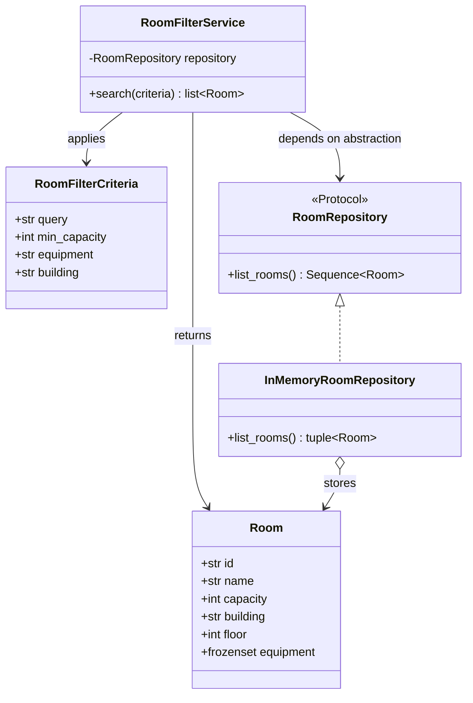

# Room filtering architecture

Room filtering is implemented as a Python application service, separate from the
existing browser UI. This keeps the domain rules independently testable and
avoids coupling the service to HTML, JavaScript, or a particular persistence
provider.

`Room` and `RoomFilterCriteria` are immutable domain values. The repository
protocol isolates data access, and `RoomFilterService` applies all supplied
criteria conjunctively. `MOCK_ROOMS` provides sample data through
`mock_data.py`; production storage can be added behind `RoomRepository` without
changing the filtering service.

The current browser pages continue to use their existing JavaScript behavior.
The Python service is not connected to the browser or exposed over HTTP; an API
adapter can be added separately if server-side integration is needed.
