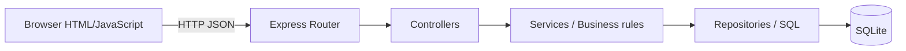
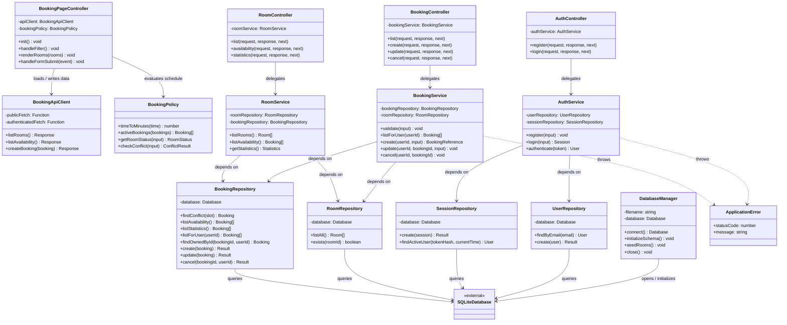

# Class design และ SOLID principles

เอกสารนี้อธิบาย Class ที่มีอยู่จริงใน Backend ของ Meetra Booking หลัง Refactor
เป็น Layered Architecture โดยแต่ละลูกศรใน Diagram สามารถตรวจสอบย้อนกลับไปยัง
Constructor dependency ใน Source code ได้

## Layered architecture



กฎ Dependency คือ Layer ด้านนอกเรียก Layer ด้านในได้ทางเดียว Controller ไม่เขียน
SQL, Service ไม่รู้จัก Express Request/Response และ Repository ไม่ตัดสิน Business rule

## Class diagram



## Responsibility ของแต่ละ Layer

| Layer | Class | Responsibility |
|---|---|---|
| Frontend controller | `BookingPageController` | ผูก Event และประสาน View/API/Policy |
| Frontend gateway | `BookingApiClient` | การเรียก HTTP API และแปลง JSON |
| Frontend domain | `BookingPolicy` | กฎสถานะห้องและตรวจเวลาชนแบบไม่พึ่ง DOM |
| Composition root | `server.js` | สร้าง Object และเชื่อม Dependency เข้าด้วยกัน |
| Controller | `AuthController`, `BookingController`, `RoomController` | แปลง HTTP request/response และส่ง Error ให้ middleware |
| Service | `AuthService`, `BookingService`, `RoomService` | Business rules, authorization decision และ use-case orchestration |
| Repository | `UserRepository`, `SessionRepository`, `RoomRepository`, `BookingRepository` | SQL และ data mapping เท่านั้น |
| Infrastructure | `DatabaseManager` | เปิด DB, สร้าง schema, seed และปิด connection |
| Error | `ApplicationError` | ส่ง status code และ safe message ข้าม Layer |

## ความสัมพันธ์ระหว่าง Object ตอน Runtime

Object ถูกสร้างและ Inject ใน [`server.js`](../../server.js) ตามลำดับ:

1. `DatabaseManager` เปิด SQLite connection
2. Connection ถูกส่งให้ Repository แต่ละตัว
3. Repository ถูกส่งให้ Service ผ่าน Constructor
4. Service ถูกส่งให้ Controller ผ่าน Constructor
5. Router ผูก Controller เข้ากับ Endpoint

ไม่มี Controller หรือ Service สร้าง Dependency ของตัวเอง ทำให้เปลี่ยน Database adapter
หรือใช้ Test double ได้โดยไม่แก้ Business logic

## การประยุกต์ใช้ SOLID

### 1. Single Responsibility Principle (SRP)

ก่อน Refactor `server.js` ทำทั้ง schema, SQL, authentication, validation และ HTTP
หลัง Refactor แต่ละ Class มีเหตุผลในการเปลี่ยนเพียงประเภทเดียว เช่น:

- [`BookingService`](../../server/services/BookingService.js) เปลี่ยนเมื่อกฎการจองเปลี่ยน
- [`BookingRepository`](../../server/repositories/BookingRepository.js) เปลี่ยนเมื่อ SQL/schema เปลี่ยน
- [`BookingController`](../../server/controllers/BookingController.js) เปลี่ยนเมื่อ HTTP contract เปลี่ยน

ตัวอย่างสำคัญคือ `BookingService.create()` ทำ orchestration ของ Use Case แต่ไม่รู้ว่า
SQL ถูกเขียนอย่างไร และไม่รู้จัก Express `request/response`

Frontend ใช้หลักเดียวกัน: [`BookingApiClient`](../../public/js/booking/BookingApiClient.js)
รับผิดชอบ HTTP, [`BookingPolicy`](../../public/js/booking/BookingPolicy.js) รับผิดชอบกฎเวลา
และ [`BookingPageController`](../../public/js/booking/BookingPageController.js) รับผิดชอบ
ประสาน DOM/Event เท่านั้น

### 2. Open/Closed Principle (OCP)

สามารถเพิ่ม Controller/Service ใหม่ เช่น `AuditService` หรือ `CalendarService` โดยประกอบ
ใน Composition Root และเพิ่ม Route โดยไม่ต้องแก้ Repository ที่ไม่เกี่ยวข้อง อย่างไรก็ตาม
ระบบยังไม่มี Plugin interface จึงถือว่าเป็นการประยุกต์ใช้ระดับพื้นฐาน

### 3. Liskov Substitution Principle (LSP)

Service พึ่งพา contract จาก method ที่ Repository เปิดเผย หาก Test double มี method และ
behavior เดียวกัน สามารถแทน Repository จริงได้ ใน JavaScript contract นี้เป็นแบบ
structural/duck typing ไม่ได้บังคับด้วย compiler

### 4. Interface Segregation Principle (ISP)

แยก Repository ตาม Aggregate แทนการมี `DatabaseRepository` ขนาดใหญ่หนึ่งตัว เช่น
`AuthService` รู้จักเฉพาะ `UserRepository` และ `SessionRepository` จึงไม่สามารถเรียก
Booking SQL ที่ไม่เกี่ยวข้องได้

### 5. Dependency Inversion Principle (DIP)

Service รับ Dependency จาก Constructor และ `server.js` เป็นผู้ประกอบ Object:

```js
const bookingRepository = new BookingRepository(database);
const roomRepository = new RoomRepository(database);
const bookingService = new BookingService(bookingRepository, roomRepository);
const bookingController = new BookingController(bookingService);
```

`BookingService` ไม่เรียก `open()` และไม่สร้าง SQLite connection เอง จึงลด Coupling ระหว่าง
Business logic กับ Infrastructure และช่วยให้ Unit test ด้วย In-memory/Test repository ได้

ฝั่ง Browser ใช้ Constructor Injection เช่นกัน โดย Controller รับ `BookingApiClient` และ
`BookingPolicy` ทำให้ Unit test Policy และ API client ได้โดยไม่ต้องเปิด Browser หรือ Server

## High Cohesion และ Low Coupling

- **High Cohesion:** method ที่เกี่ยวกับกฎจองอยู่ใน `BookingService`; SQL จองอยู่ใน
  `BookingRepository`
- **Low Coupling:** Controller รู้จักเพียง Service; Service รู้จัก Repository interface;
  Repository รู้จัก SQLite
- **Stable API:** Frontend และ Integration tests ใช้ Endpoint เดิมทั้งหมด จึง Refactor
  ภายในได้โดยไม่เปลี่ยนผู้ใช้งานภายนอก

## ข้อจำกัดและโอกาส Refactor ต่อ

1. JavaScript ไม่มี Interface type checking; หากต้องการ contract ที่ compile-time ชัดเจน
   สามารถใช้ TypeScript หรือเพิ่ม interface documentation
2. Conflict check กับ write ยังไม่ atomic ควรเพิ่ม Transaction/locking
3. Security logging และ logout/revoke session ยังไม่มี
4. ควรเพิ่ม Unit tests แยกสำหรับ Service โดย Inject fake repositories
5. Frontend rendering ยังอยู่ใน `BookingPageController`; หาก UI โตขึ้นควรแยก `BookingPageView`

