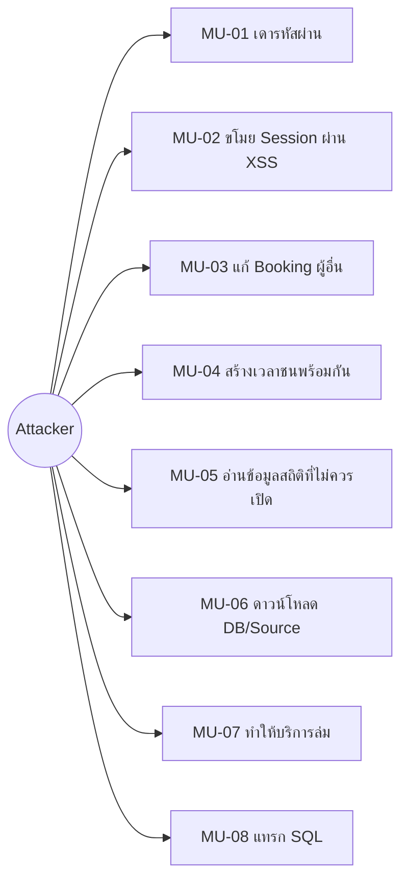

# Misuse cases

## Actors

| Actor | คำอธิบาย |
|---|---|
| Legitimate user | ผู้ใช้ที่สมัครและเข้าสู่ระบบตามปกติ |
| Anonymous attacker | บุคคลภายนอกที่ไม่มีบัญชีหรือ Session |
| Malicious user | ผู้ใช้ที่มีบัญชีแต่พยายามเข้าถึงข้อมูลผู้อื่น |
| Automated bot | Script ที่ยิง Login/API จำนวนมาก |
| Compromised dependency/operator | Dependency หรือผู้ดูแลระบบที่ถูกยึดบัญชี |

## Misuse-case overview

## รายละเอียด

### MU-01 — Brute-force login

- **เป้าหมาย:** ยึดบัญชีผู้ใช้
- **เงื่อนไข:** รู้หรือเดาอีเมลผู้ใช้ได้
- **เส้นทาง:** ส่ง `POST /api/login` ซ้ำด้วยรหัสผ่านหลายค่า
- **ผลกระทบ:** เข้าถึงและแก้รายการจองในนามเจ้าของบัญชี
- **ปัจจุบัน:** Password ใช้ scrypt และข้อความผิดพลาดไม่แยกว่าพบอีเมลหรือไม่
- **ช่องว่าง:** ไม่มี rate limit, delay, CAPTCHA หรือ monitoring
- **Requirement:** `SR-AUTH-004`, `SR-LOG-001`

### MU-02 — Stored XSS เพื่อขโมย Session

- **เป้าหมาย:** อ่าน Bearer token จาก `localStorage`
- **เงื่อนไข:** สามารถบันทึกข้อความที่ถูกนำไปใส่ `innerHTML`
- **เส้นทาง:** ใส่ HTML/JavaScript ใน purpose แล้วเปิดหน้ารายการจอง
- **ผลกระทบ:** Script ทำงานใน origin เดียวกันและเข้าถึง Session ได้
- **ปัจจุบัน:** หน้าสถิติมี `escapeHtml` แต่หน้า My Bookings ยังแทรกข้อมูลบางส่วนใน template
- **Requirement:** `SR-WEB-001`, `SR-WEB-002`, `SR-SES-003`

### MU-03 — IDOR / แก้ไขรายการของผู้อื่น

- **เป้าหมาย:** แก้หรือยกเลิก Booking ของผู้ใช้อื่น
- **เงื่อนไข:** มีบัญชีและรู้ Booking ID
- **เส้นทาง:** เปลี่ยน `:id` ใน PUT/PATCH
- **ผลกระทบ:** ความถูกต้องและความพร้อมใช้งานของห้องเสียหาย
- **ปัจจุบัน:** SQL ตรวจทั้ง Booking ID และ authenticated `user_id`
- **ผลการทดสอบ:** ผู้ใช้คนที่สองได้รับ 404 เมื่อแก้/ยกเลิกรายการของคนแรก
- **Requirement:** `SR-AUTHZ-001`

### MU-04 — Race condition สร้าง Double booking

- **เป้าหมาย:** จองห้องและช่วงเวลาเดียวกันมากกว่าหนึ่งรายการ
- **เงื่อนไข:** ส่ง Request พร้อมกันก่อนรายการแรก Commit
- **เส้นทาง:** POST สอง Request ที่ผ่าน SELECT conflict ก่อน INSERT
- **ผลกระทบ:** ตารางการจองไม่ถูกต้อง
- **ปัจจุบัน:** ตรวจ overlap ก่อน INSERT แต่ยังไม่มี Transaction/locking
- **Requirement:** `SR-BOOK-002`

### MU-05 — Information disclosure ผ่าน Statistics API

- **เป้าหมาย:** เก็บข้อมูลการใช้งานและวัตถุประสงค์การจอง
- **เงื่อนไข:** ไม่ต้อง Login
- **เส้นทาง:** เรียก `GET /api/statistics`
- **ผลกระทบ:** เปิดเผยข้อมูลกิจกรรมภายในเกินความจำเป็น
- **ปัจจุบัน:** Response มี booking purpose แม้ UI ไม่ได้นำไปแสดง
- **Requirement:** `SR-PRIV-001`

### MU-06 — ดาวน์โหลด Database หรือ Source

- **เป้าหมาย:** ขโมยข้อมูล Credential hash, Session และ Booking
- **เส้นทาง:** ขอ `/kmitl_booking.db`, `/server.js` หรือ path traversal
- **ปัจจุบัน:** Express serve เฉพาะ `dist/`; มี Integration test ยืนยัน 404
- **Requirement:** `SR-DATA-002`

### MU-07 — Resource exhaustion / DoS

- **เป้าหมาย:** ทำให้ระบบตอบสนองช้าหรือหยุดบริการ
- **เส้นทาง:** ยิง register/login เพื่อบังคับ scrypt หรือส่ง API จำนวนมาก
- **ปัจจุบัน:** JSON limit 32 KB
- **ช่องว่าง:** ไม่มี global/auth rate limit และ monitoring
- **Requirement:** `SR-AVAIL-001`, `SR-LOG-001`

### MU-08 — SQL injection

- **เป้าหมาย:** อ่านหรือแก้ไข SQLite นอกเหนือสิทธิ์
- **เส้นทาง:** ใส่ SQL syntax ใน email, purpose หรือ URL parameter
- **ปัจจุบัน:** Query ที่รับ Input ใช้ placeholders/parameters
- **Requirement:** `SR-DATA-001`

## Abuse stories สำหรับใช้ในสไลด์

- ในฐานะผู้โจมตี ฉันต้องการเดารหัสผ่านจำนวนมาก เพื่อยึดบัญชีผู้ใช้
- ในฐานะผู้ใช้ที่ประสงค์ร้าย ฉันต้องการเปลี่ยน Booking ID เพื่อยกเลิกรายการของผู้อื่น
- ในฐานะผู้โจมตี ฉันต้องการฝัง Script ในข้อมูลการจอง เพื่อขโมย Session token
- ในฐานะ Bot ฉันต้องการส่งคำขอพร้อมกัน เพื่อสร้าง Double booking
- ในฐานะบุคคลภายนอก ฉันต้องการเรียก Statistics API เพื่อเก็บข้อมูลกิจกรรมภายใน

