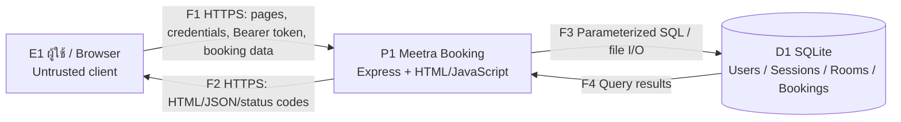
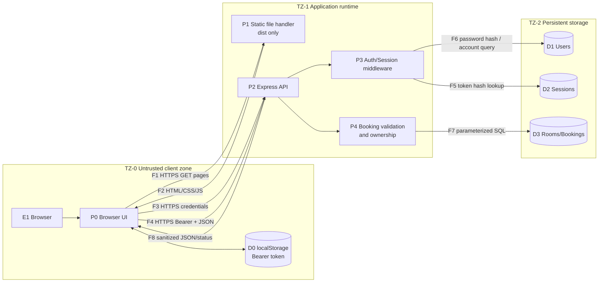

# Threat analysis และ Data Flow Diagram

## 1. ข้อมูลแบบจำลอง

| รายการ | ค่า |
|---|---|
| ระบบ | Meetra Booking |
| เวอร์ชันที่ประเมิน | `main@b75b2c9` |
| วันที่ประเมิน | 13 พฤศจิกายน 2026 |
| เจ้าของเอกสาร | ทีม Meetra Booking |
| ผู้ทบทวน | TBD — QA/Security reviewer |
| วิธีจำแนก Threat | STRIDE |

## 2. เป้าหมายด้านความปลอดภัย

1. ผู้ใช้ต้องเข้าถึงและแก้ไขเฉพาะรายการจองของตนเอง
2. Password และ Session token ต้องไม่ถูกเก็บในรูปแบบที่นำไปใช้ได้ทันที
3. รายการจองต้องไม่ถูกปลอม แก้ไข หรือสร้างเวลาชนกันโดยไม่ได้รับอนุญาต
4. ข้อมูลผู้ใช้และวัตถุประสงค์การจองต้องไม่รั่วไหลเกินความจำเป็น
5. Source code และไฟล์ SQLite ต้องไม่ถูกเปิดผ่าน Static web server
6. ระบบต้องยังให้บริการได้เมื่อพบ Input ผิดรูปแบบหรือการเรียกใช้งานจำนวนมาก

## 3. สมมติฐานและข้อจำกัด

- Production ต้องให้บริการผ่าน HTTPS เท่านั้น
- Browser และข้อมูลที่ส่งจาก Browser ถือว่าไม่น่าเชื่อถือ
- Express และ SQLite ทำงานใน Service เดียวกัน แต่ไฟล์ฐานข้อมูลเป็นอีก Trust
  Zone เพราะต้องควบคุมสิทธิ์ไฟล์และ Persistent Volume แยกจาก Static files
- ผู้ให้บริการ Hosting, GitHub และ npm registry เป็น External Dependencies
- ระบบปัจจุบันไม่มี Administrator workflow และไม่มี Third-party identity provider
- SQLite เหมาะกับ Demo/งานขนาดเล็ก แต่ไม่รับประกันการเขียนพร้อมกันหลาย Instance

## 4. Entry points

| ID | Entry point | Trust level | ข้อมูลที่รับ |
|---|---|---|---|
| EP-01 | `POST /api/register` | Anonymous | name, email, password |
| EP-02 | `POST /api/login` | Anonymous | email, password |
| EP-03 | `GET /api/rooms` | Public | ไม่มี |
| EP-04 | `GET /api/availability` | Public | ไม่มี |
| EP-05 | `GET /api/statistics` | Public | ไม่มี |
| EP-06 | `GET /api/bookings` | Authenticated | Bearer token |
| EP-07 | `POST /api/bookings` | Authenticated | room, date, time, purpose |
| EP-08 | `PUT /api/bookings/:id` | Owner | booking ID และข้อมูลแก้ไข |
| EP-09 | `PATCH /api/bookings/:id/cancel` | Owner | booking ID |
| EP-10 | Static pages ใน `dist/` | Public | URL path |

## 5. DFD ระดับ 0 — System context

## 6. DFD ระดับ 1 — Processes และ Trust Boundaries

### Trust boundaries

| ID | Boundary | ความเสี่ยงหลัก | Control ปัจจุบัน |
|---|---|---|---|
| TB-01 | Browser ↔ Express | ดักข้อมูล, ปลอม Request, XSS, Token theft | Bearer token, server validation; HTTPS ต้องตั้งที่ Hosting |
| TB-02 | Anonymous ↔ Authenticated API | Brute force, session forgery, IDOR | scrypt, random opaque token, token hash, expiry, ownership SQL |
| TB-03 | Express process ↔ SQLite file | SQL injection, file tampering, data loss | Parameterized SQL, DB อยู่นอก `dist`; backup/volume ยังต้องทำ |
| TB-04 | Source/Build ↔ Production | dependency tampering, deploy โค้ดที่ test ไม่ผ่าน | lockfile มีแล้ว; CI/CD และ branch protection ยัง Planned |

## 7. STRIDE threat analysis

| Threat ID | STRIDE | เป้าหมาย/Flow | Threat scenario | Control ปัจจุบัน | Gap / Requirement |
|---|---|---|---|---|---|
| T-01 | Spoofing | EP-02, TB-02 | เดารหัสผ่านเพื่อสวมรอยผู้ใช้ | scrypt, ข้อความผิดพลาดแบบรวม | ไม่มี rate limit — `SR-AUTH-004` |
| T-02 | Spoofing | D0, F4 | ขโมย Bearer token จาก Browser แล้วใช้แทนเจ้าของ | token สุ่ม, เก็บ hash, มี expiry | token อยู่ localStorage; ต้องป้องกัน XSS/เพิ่ม logout — `SR-SES-003`, `SR-WEB-001` |
| T-03 | Tampering | EP-08/09 | เปลี่ยน booking ID เพื่อแก้หรือยกเลิกรายการของผู้อื่น | Query ผูก `user_id` กับ authenticated user | เพิ่ม negative tests และ audit log — `SR-AUTHZ-001`, `SR-LOG-001` |
| T-04 | Tampering | F7, D3 | SQL injection ผ่าน Input | Parameterized SQL | รักษา parameterization และเพิ่ม security test — `SR-DATA-001` |
| T-05 | Tampering | D3 | ผู้ใช้สองคนจองช่วงเดียวกันพร้อมกันจนผ่าน conflict check | ตรวจ overlap ก่อนเขียน | Check/insert ยังไม่ atomic — `SR-BOOK-002` |
| T-06 | Repudiation | EP-07/08/09 | ผู้ใช้ปฏิเสธว่าไม่ได้สร้าง/แก้/ยกเลิกการจอง | มี `created_at` บางตาราง | ไม่มี audit event ที่ระบุ actor/action/time — `SR-LOG-001` |
| T-07 | Information disclosure | EP-05 | Anonymous อ่านข้อมูลสถิติและวัตถุประสงค์การจองทั้งหมดจาก API | UI ไม่แสดง purpose | API ยังส่ง purpose — `SR-PRIV-001` |
| T-08 | Information disclosure | EP-10 | ดาวน์โหลด DB หรือ source ผ่าน URL | Serve เฉพาะ `dist`, ignore `*.db` | เพิ่ม regression test ใน CI — `SR-DATA-002` |
| T-09 | Information disclosure | TB-01 | Credential/token ถูกดักเมื่อใช้ HTTP | ไม่มี credential ใน URL | บังคับ HTTPS/HSTS ที่ Production — `SR-TRANS-001` |
| T-10 | Denial of service | EP-01/02 | ยิง scrypt/login จำนวนมากใช้ CPU | จำกัด JSON 32 KB | ไม่มี throttling/rate limit — `SR-AVAIL-001` |
| T-11 | Denial of service | D3 | SQLite สูญหาย/ล็อก/Volume เต็ม | SQLite file แยกใน `data/` | Persistent volume, backup, health check — `SR-DATA-003` |
| T-12 | Elevation of privilege | EP-06–09 | Anonymous หรือ user อื่นเรียก Protected API | Auth middleware และ ownership checks | เพิ่ม test ทุก protected endpoint — `SR-AUTHZ-001` |
| T-13 | Elevation of privilege | Browser DOM | Stored XSS จาก purpose/room fields รัน script และอ่าน token | บางหน้ามี `escapeHtml` | `my-bookings` ยังใช้ `innerHTML` กับข้อมูล — `SR-WEB-001` |
| T-14 | Supply chain | TB-04 | Dependency หรือ build ที่มีช่องโหว่ถูก Deploy | `package-lock.json`, audit ปัจจุบันผ่าน | CI audit, Dependabot, pinned Actions — `SR-SUP-001` |

## 8. จุดควบคุมที่มีอยู่จริง

- Password hashing: [`server.js`](../../server.js#L39-L43)
- Unique salt และ random session token: [`server.js`](../../server.js#L134-L154)
- Authentication middleware: [`server.js`](../../server.js#L107-L121)
- Booking validation/conflict: [`server.js`](../../server.js#L78-L94)
- Ownership checks: [`server.js`](../../server.js#L214-L237)
- Static isolation: [`server.js`](../../server.js#L241-L247)
- Integration tests: [`tests/api.integration.test.js`](../../tests/api.integration.test.js)

## 9. เงื่อนไขการทบทวนใหม่

ต้องทบทวน Threat Model เมื่อเกิดอย่างใดอย่างหนึ่ง:

- เพิ่ม Admin role หรือระบบอนุมัติ
- เปลี่ยน SQLite เป็น Cloud database
- เพิ่ม Calendar/Email integration
- เปลี่ยน Session storage หรือ Authentication provider
- Deploy บนหลาย Instance
- เกิด Security incident หรือพบช่องโหว่ระดับ High/Critical

